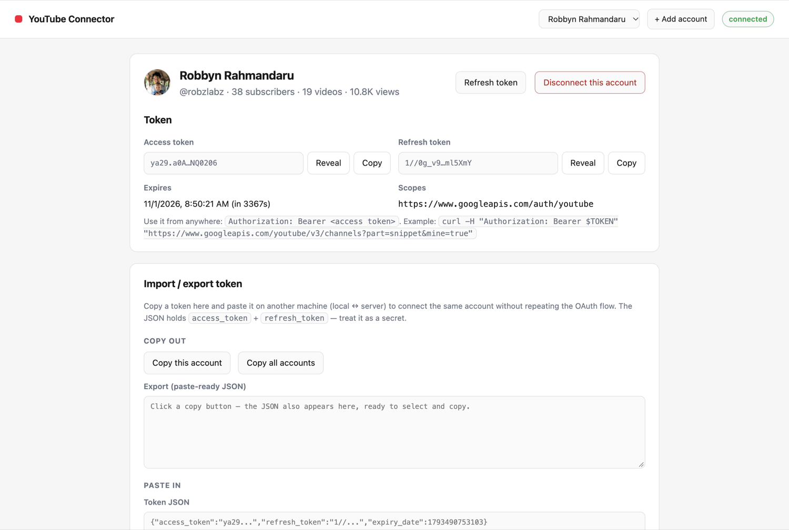
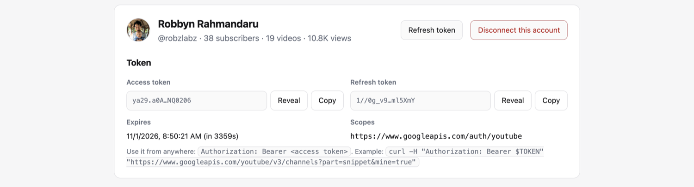
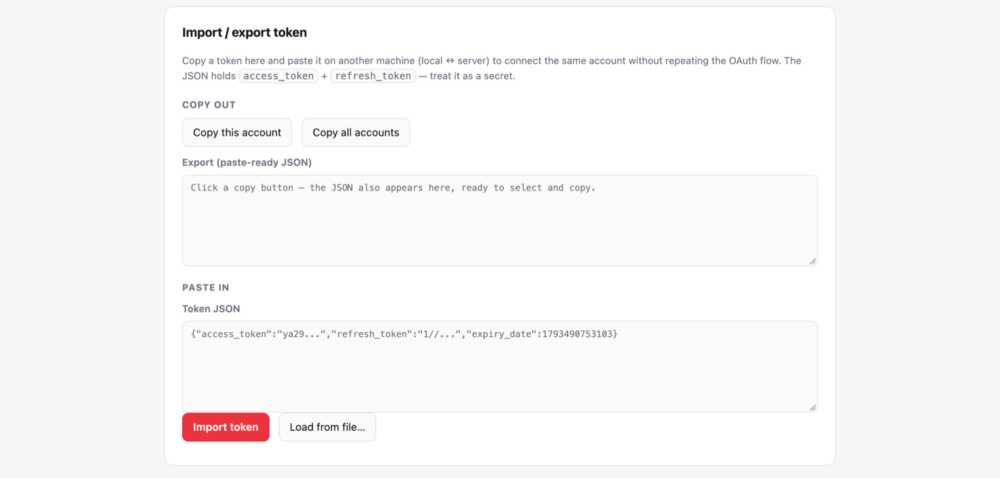
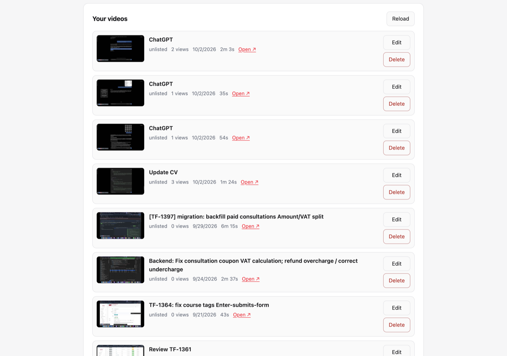
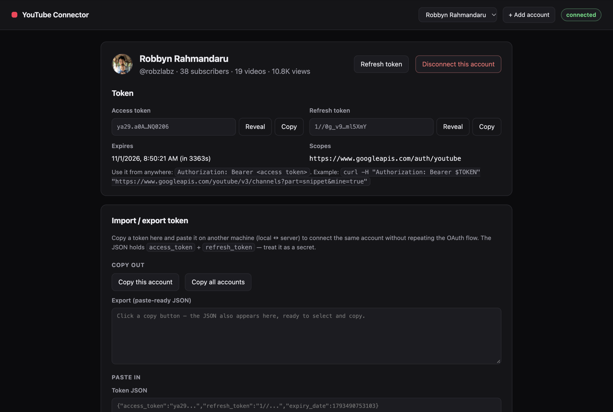
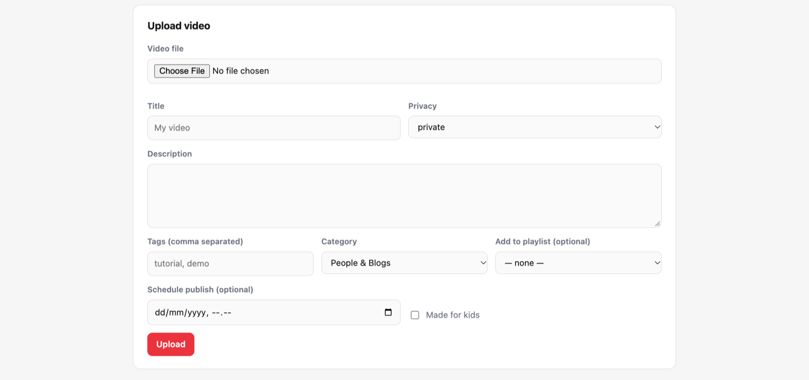

# YouTube Connector + MCP

A local Node.js app that connects **one or many** YouTube channels through Google OAuth 2.0, shows you the resulting tokens (copy / paste between machines), and lets you **upload and manage videos** — from the browser UI, from a REST API, or from any AI agent over a **Streamable HTTP MCP** endpoint that needs nothing installed on the client.



```
┌────────────┐  1. Connect        ┌───────────────┐  2. login + consent  ┌──────────────┐
│  Browser   │ ─────────────────► │  App :3000    │ ───────────────────► │   Google     │
│ localhost  │                    │  /auth/start  │                      │  OAuth 2.0   │
│            │ ◄───────────────── │  /oauth2cb    │ ◄─────────────────── │  consent     │
└────────────┘  4. token di UI    └───────────────┘  3. ?code= (redirect)└──────────────┘
        │                                  │
        │                                  ├─► data/tokens.json  (one entry per channel, mode 600)
        │                                  ├─► YouTube Data API v3  (upload & manage)
        ▼                                  │
  copy / paste token  ◄──────────►  AI agent ──► POST /mcp  (MCP Streamable HTTP, 14 tools)
```

---

## Daftar isi

1. [Fitur](#1-fitur)
2. [Kebutuhan](#2-kebutuhan)
3. [Setup Google Cloud Console](#3-setup-google-cloud-console)
4. [Install & konfigurasi](#4-install--konfigurasi)
5. [Menjalankan aplikasi](#5-menjalankan-aplikasi)
6. [Alur connect sampai dapat token](#6-alur-connect-sampai-dapat-token)
7. [Multiple YouTube account](#7-multiple-youtube-account)
8. [Copy / paste token antar mesin](#8-copy--paste-token-antar-mesin)
9. [Upload & manage video](#9-upload--manage-video)
10. [REST API reference](#10-rest-api-reference)
11. [MCP server (Streamable HTTP)](#11-mcp-server-streamable-http)
12. [Siklus hidup token](#12-siklus-hidup-token)
13. [Troubleshooting](#13-troubleshooting)
14. [Keamanan & catatan](#14-keamanan--catatan)
15. [Struktur project](#15-struktur-project)

---

## 1. Fitur

| Fitur | Keterangan |
|---|---|
| **OAuth 2.0 lokal** | Consent Google → callback `localhost:3000/oauth2callback` → token disimpan lokal. Tidak ada server pihak ketiga. |
| **Token tampil di UI** | Access token + refresh token, ter-mask dengan tombol **Reveal** / **Copy**, plus expiry dan scope. |
| **Multiple account** | Setiap consent menambah satu channel. Ada dropdown account aktif di topbar; semua endpoint & tool menerima pemilih account. |
| **Import / export token** | Copy JSON token ke mesin lain (local ↔ server), paste, langsung terhubung tanpa OAuth ulang. Bisa 1 account atau semuanya. |
| **Upload video** | Resumable upload streaming dari disk (file besar tidak masuk RAM), title/description/tags/category/privacy, jadwal publish, langsung masuk playlist. |
| **Manage video** | List + pagination, edit (judul, deskripsi, tags, kategori, privacy), hapus, playlist (list/buat/tambah video). |
| **REST API** | Semua operasi tersedia sebagai HTTP JSON, dengan pemilih account lewat `?account=`. |
| **MCP Streamable HTTP** | `POST /mcp`, stateless, 14 tool, `instructions` bawaan supaya AI tahu urutan pemakaian. Tanpa install apa pun di client. |
| **UI** | Satu halaman, light + dark mode otomatis, tanpa build step. |

| Token & account | Copy / paste | Manage video |
|---|---|---|
|  |  |  |

<details>
<summary>Dark mode &amp; form upload</summary>




</details>

---

## 2. Kebutuhan

| Hal | Keterangan |
|---|---|
| Node.js | >= 20 (dites di v22) |
| Akun Google | yang punya channel YouTube |
| Google Cloud project | gratis, untuk OAuth Client ID |
| Port lokal | default `3000` (bisa diganti via `PORT`) |

---

## 3. Setup Google Cloud Console

Sekali saja per project.

### 3.1 Buat project

<https://console.cloud.google.com/> → dropdown project → **New Project** → beri nama → **Create**.

### 3.2 Aktifkan YouTube Data API v3

**APIs & Services** → **Library** → cari **YouTube Data API v3** → **Enable**.
Tanpa ini semua request gagal `403 accessNotConfigured`.

### 3.3 OAuth consent screen / Google Auth Platform

1. **APIs & Services** → **OAuth consent screen** (di console baru: **Google Auth Platform**)
2. **External** → **Create**, isi app name + support email + developer contact.
3. **Data access** → **Add or remove scopes** → tambahkan
   `https://www.googleapis.com/auth/youtube` → **Update** → **Save**.
4. Kalau app masih **Testing**: **Audience** → **Test users** → tambahkan email Google yang akan connect.

> **Testing vs Production**
> - **Testing**: hanya *Test users* yang bisa connect (maks 100), dan **refresh token kedaluwarsa 7 hari** → connect ulang tiap minggu.
> - **In production** (belum diverifikasi): refresh token tidak kedaluwarsa, tetapi consent menampilkan layar **“Google hasn't verified this app”** → **Advanced** → **Go to … (unsafe)** → **Continue**. Batas tetap 100 login sensitif seumur project.

### 3.4 Buat OAuth Client ID

**APIs & Services** → **Credentials** → **Create credentials** → **OAuth client ID**

- **Application type**: **Web application**
- **Name**: `youtube-connector-local` (bebas)
- **Authorized redirect URIs** → **Add URI**:
  ```
  http://localhost:3000/oauth2callback
  ```
  Harus **persis** sama dengan `GOOGLE_REDIRECT_URI` (skema, host, port, path, tanpa trailing slash).
- **Create** → copy **Client ID** dan **Client secret**.

Contoh hasilnya:

```
Client ID      YOUR_CLIENT_ID.apps.googleusercontent.com
Client secret  YOUR_CLIENT_SECRET
```

---

## 4. Install & konfigurasi

```bash
git clone https://github.com/robzlabz/youtube_connector_with_mcp.git
cd youtube_connector_with_mcp
npm install
cp .env.example .env
```

Isi `.env`:

```ini
GOOGLE_CLIENT_ID=YOUR_CLIENT_ID.apps.googleusercontent.com
GOOGLE_CLIENT_SECRET=YOUR_CLIENT_SECRET
PORT=3000
```

| Variabel | Wajib | Default | Keterangan |
|---|---|---|---|
| `GOOGLE_CLIENT_ID` | ya | — | dari langkah 3.4 |
| `GOOGLE_CLIENT_SECRET` | ya | — | dari langkah 3.4 |
| `PORT` | tidak | `3000` | port lokal app + MCP |
| `GOOGLE_REDIRECT_URI` | tidak | `http://localhost:$PORT/oauth2callback` | override kalau beda host/port |
| `GOOGLE_SCOPES` | tidak | `https://www.googleapis.com/auth/youtube` | pisahkan spasi/koma kalau perlu scope tambahan |
| `MAX_UPLOAD_MB` | tidak | `2048` | batas ukuran file upload (MB) |
| `HOST` | tidak | `127.0.0.1` | interface bind |
| `TOKEN_FILE` | tidak | `data/tokens.json` | lokasi token store (berguna untuk testing) |

---

## 5. Menjalankan aplikasi

```bash
npm start          # atau: npm run dev  (auto-reload)
```

```
YouTube connector running at http://localhost:3000
MCP (Streamable HTTP): http://localhost:3000/mcp
Redirect URI (must match Google Cloud Console): http://localhost:3000/oauth2callback
```

Buka <http://localhost:3000>. Kalau `.env` belum lengkap, halaman menampilkan banner merah berisi variabel yang kurang dan tombol **Connect** dinonaktifkan.

---

## 6. Alur connect sampai dapat token

1. Klik **Connect to YouTube** → `GET /auth/start` → `https://accounts.google.com/o/oauth2/v2/auth?...`
   (`access_type=offline`, `prompt=consent`, `scope=.../auth/youtube`, `state=<acak>`).
2. Login, pilih channel (akun pribadi atau brand account), setujui **“Manage your YouTube account”**.
3. Google redirect ke `http://localhost:3000/oauth2callback?code=...&state=...`.
4. Server memverifikasi `state` (sekali pakai, 10 menit), menukar `code` ke token, **memanggil YouTube untuk memastikan token benar** dan membaca identitas channel, lalu menyimpan semuanya ke `data/tokens.json`.
5. Redirect ke `/?connected=1` — token tampil di UI.

Contoh isi `data/tokens.json`:

```json
{
  "version": 2,
  "activeAccountId": "6e88e76d-c488-f3cd-5215-b52c54db3916",
  "accounts": [
    {
      "id": "6e88e76d-c488-f3cd-5215-b52c54db3916",
      "channelId": "UCyFRZZdPCDMdDkeuwuy2JxA",
      "channelTitle": "Robbyn Rahmandaru",
      "access_token": "ya29.EXAMPLE_ACCESS_TOKEN",
      "refresh_token": "1//EXAMPLE_REFRESH_TOKEN",
      "token_type": "Bearer",
      "scope": "https://www.googleapis.com/auth/youtube",
      "expiry_date": 1793497821894
    }
  ]
}
```

---

## 7. Multiple YouTube account

Connect sebanyak yang kamu mau:

- **+ Add account** di topbar (atau tombol **Connect another YouTube account**) menjalankan consent lagi; channel yang dipilih **ditambahkan** sebagai account baru dan langsung jadi aktif.
- Dropdown di topbar berisi semua account; memilih satu akan mengaktifkannya (`POST /api/accounts/:id/activate`) dan me-reload video + playlist.
- Setiap endpoint/tool menerima pemilih account: `?account=`, header `X-YouTube-Account`, atau argumen `account` di MCP. Nilainya boleh **id account**, **channel id (`UC...`)**, atau **judul channel**.
- Tanpa pemilih, yang dipakai adalah account **aktif**.
- Import token yang channel-nya sudah ada **meng-update** entri itu, bukan menduplikasi (dicocokkan lewat `channelId`).
- **Disconnect this account** me-revoke satu account saja di Google dan menghapusnya dari store; account lain tidak tersentuh.

Contoh:

```bash
curl -s localhost:3000/api/accounts | jq
curl -s "localhost:3000/api/videos?account=UCyFRZZdPCDMdDkeuwuy2JxA" | jq '.items[0]'
curl -s -X POST localhost:3000/api/accounts/<id>/activate | jq '.activeAccountId'
```

---

## 8. Copy / paste token antar mesin

Kartu **Import / export token** memindahkan koneksi tanpa OAuth ulang — misal connect di laptop, lalu pakai di server.

**Copy out**

| Tombol | Isi |
|---|---|
| **Copy this account** | JSON satu account (id, channel, `access_token`, `refresh_token`, `expiry_date`, …) |
| **Copy all accounts** | seluruh store (`{version, activeAccountId, accounts:[…]}`) |

JSON juga muncul di textarea *Export* dan otomatis ter-select, jadi tetap bisa di-copy manual kalau clipboard diblokir browser.

**Paste in**

Tempel JSON (satu account **atau** seluruh store) → **Import token**. Format yang diterima:

```json
{"channelId":"UC...","access_token":"ya29...","refresh_token":"1//...","expiry_date":1793497821894}
```
```json
{"version":2,"activeAccountId":"...","accounts":[{ "...": "..." }]}
```
```json
{"access_token":"ya29...","refresh_token":"1//..."}     ← minimal
```

Setelah paste, server **memverifikasi token ke YouTube dulu** (dan mencoba refresh sekali). Kalau ditolak, tidak ada yang disimpan dan account lama tetap aktif. Token tanpa `refresh_token` diterima tapi akan mati ~1 jam kemudian — export selalu menyertakan refresh token.

Lewat API:

```bash
curl -s -X POST localhost:3000/api/accounts/import \
  -H 'Content-Type: application/json' \
  -d '{"token":"<paste JSON>","activate":true}' | jq

curl -s localhost:3000/api/export | jq          # semua account, siap paste
```

> Simpan JSON ini seperti password: siapa pun yang memegangnya bisa mengelola channel sampai token di-revoke.

---

## 9. Upload & manage video

| Kartu | Fungsi |
|---|---|
| **Upload video** | pilih file → title/description/tags/privacy/category → opsional jadwal publish & playlist → progress bar → video masuk sebagai `private` (default) |
| **Your videos** | daftar video terbaru (thumbnail, privacy, views, durasi), **Edit** (judul, deskripsi, tags, privacy, kategori, tambah ke playlist), **Delete**, **Load more** |
| **Playlists** | daftar playlist + buat playlist baru (private/unlisted/public) |

Catatan upload:

- **Resumable upload** dengan streaming dari disk (`Readable.toWeb(createReadStream)`) — file besar tidak masuk RAM.
- Default privacy **private**; ubah ke `unlisted`/`public` bila perlu.
- Kalau **Schedule publish** diisi, YouTube mewajibkan video `private` saat upload — app mengatur otomatis.
- File sementara di `data/uploads/` selalu dihapus setelah upload (sukses maupun gagal).
- Kuota: 1 upload = 1.600 unit dari 10.000/hari → praktis ~6 upload/hari per project.

---

## 10. REST API reference

Semua endpoint mengembalikan JSON. Error berbentuk `{ "error": { "message": "...", "code": "..." } }`.
Pemilih account: `?account=<id|UC...|judul>`, header `X-YouTube-Account`, atau body `account`.

| Method | Path | Fungsi |
|---|---|---|
| GET | `/api/health` | liveness |
| GET | `/api/config` | status konfigurasi + redirect URI + scopes |
| GET | `/api/status` | konfigurasi, connected, daftar account, token aktif, info channel |
| GET | `/auth/url` | URL consent Google (JSON) — untuk automation |
| GET | `/auth/start` | redirect ke Google consent |
| GET | `/oauth2callback` | callback OAuth (dipakai Google) |
| GET | `/api/accounts` | daftar account + `activeAccountId` |
| POST | `/api/accounts/import` | import token (`{token, activate}`) |
| POST | `/api/accounts/:id/activate` | jadikan account aktif |
| DELETE | `/api/accounts/:id` | revoke + hapus satu account |
| GET | `/api/accounts/:id/export` | JSON paste-ready satu account |
| GET | `/api/export` | JSON paste-ready semua account |
| GET | `/api/token` | access token valid (auto-refresh) |
| POST | `/api/token/refresh` | paksa refresh access token |
| POST | `/api/disconnect` | revoke + hapus account yang dipilih |
| GET | `/api/videos?maxResults=25&pageToken=` | daftar video channel |
| GET | `/api/videos/:id` | detail satu video |
| PATCH | `/api/videos/:id` | update `title`, `description`, `tags`, `categoryId`, `privacyStatus` |
| DELETE | `/api/videos/:id` | hapus video |
| GET | `/api/playlists` | daftar playlist |
| POST | `/api/playlists` | buat playlist (`title`, `description`, `privacyStatus`) |
| POST | `/api/playlists/:id/items` | tambah video ke playlist (`videoId`) |
| POST | `/api/upload` | multipart upload (`video`, `title`, `description`, `tags`, `privacyStatus`, `categoryId`, `madeForKids`, `publishAt`, `playlistId`) |
| POST | `/mcp` | MCP Streamable HTTP (lihat bagian 11) |

```bash
# status + token
curl -s localhost:3000/api/status | jq
curl -s localhost:3000/api/token | jq -r .accessToken

# 5 video terbaru
curl -s "localhost:3000/api/videos?maxResults=5" | jq '.items[] | {id, title, privacyStatus}'

# ubah privacy
curl -s -X PATCH localhost:3000/api/videos/VIDEO_ID \
  -H 'Content-Type: application/json' -d '{"privacyStatus":"unlisted"}' | jq

# upload
curl -s -X POST localhost:3000/api/upload \
  -F video=@/path/video.mp4 -F title='Video uji' -F privacyStatus=private | jq

# upload ke account tertentu
curl -s -X POST "localhost:3000/api/upload?account=UC..." \
  -F video=@/path/video.mp4 -F title='Video uji' | jq
```

---

## 11. MCP server (Streamable HTTP)

Proses yang sama juga menjadi **MCP server**, jadi AI (omp, [CC], Cursor, dll.) bisa memakai channel kamu tanpa menulis kode. Transportnya **Streamable HTTP**: **tidak ada yang perlu di-install** di sisi client, cukup satu URL.

```
http://localhost:3000/mcp
```

- Hidup selama `npm start` berjalan (port sama dengan UI, ikut `PORT`).
- **Stateless** — tanpa `Mcp-Session-Id`; setiap `POST` berdiri sendiri dan boleh paralel.
- Respons JSON (`enableJsonResponse`), tetap kompatibel dengan client yang minta `text/event-stream`.
- Server mengirim `instructions` saat `initialize`: urutan pemakaian, cara memilih account, dan fakta penting (quota, path lokal, delete permanen).

### 11.1 Daftarkan di client

**omp** — `~/.omp/agent/mcp.json`:

```json
{
  "mcpServers": {
    "youtube": { "type": "http", "url": "http://localhost:3000/mcp" }
  }
}
```

**[CC]:**

```bash
claude mcp add --transport http youtube http://localhost:3000/mcp
```

**Cursor** (`.cursor/mcp.json`):

```json
{
  "mcpServers": {
    "youtube": { "url": "http://localhost:3000/mcp" }
  }
}
```

**Client yang hanya mendukung stdio** (Claude Desktop) — bungkus dengan bridge:

```json
{
  "mcpServers": {
    "youtube": {
      "command": "npx",
      "args": ["-y", "mcp-remote", "http://localhost:3000/mcp"]
    }
  }
}
```

### 11.2 Tools (14)

| Tool | Argumen | Fungsi |
|---|---|---|
| `youtube_status` | `account?` | config, daftar account, account aktif, info channel, expiry token. **Panggil pertama.** |
| `youtube_accounts` | `activate?` | daftar account / ganti account aktif |
| `youtube_connect_url` | — | URL consent sekali pakai (10 menit) untuk menambah account |
| `youtube_import_token` | `token`, `activate?` | import token hasil paste (single / whole store / raw string) |
| `youtube_export_token` | `account?`, `all?` | JSON paste-ready satu account atau semua |
| `youtube_get_token` | `account?` | access token valid + contoh `curl` |
| `youtube_list_videos` | `maxResults?`, `pageToken?`, `account?` | daftar video terbaru |
| `youtube_get_video` | `videoId`, `account?` | detail satu video |
| `youtube_update_video` | `videoId`, `title?`, `description?`, `tags?`, `categoryId?`, `privacyStatus?`, `account?` | ubah metadata |
| `youtube_upload_video` | `filePath` (absolut), `title`, `description?`, `tags?`, `privacyStatus?`, `categoryId?`, `playlistId?`, `madeForKids?`, `publishAt?`, `account?` | upload resumable dari file lokal |
| `youtube_delete_video` | `videoId`, `account?` | hapus permanen |
| `youtube_list_playlists` | `account?` | daftar playlist |
| `youtube_create_playlist` | `title`, `description?`, `privacyStatus?`, `account?` | buat playlist |
| `youtube_add_video_to_playlist` | `playlistId`, `videoId`, `account?` | masukkan video ke playlist |

Semua tool mengembalikan JSON di `content[0].text`; kegagalan datang sebagai `isError: true` dengan pesan yang bisa langsung ditindak AI, mis. `Error: File not found: /tmp/nope.mp4` atau `Error: Unknown account "x". Known accounts: …`.

### 11.3 Contoh prompt

- “Cek channel YouTube saya, tampilkan 5 video terakhir.”
- “Ada berapa account yang terhubung? Pindah ke channel RobzLabz Blog.”
- “Upload `/Users/robbyn/Movies/demo.mp4` sebagai `private`, judul ‘Demo MCP’, masukkan ke playlist SEO.”
- “Video terbaru yang judulnya ChatGPT, ubah privacy-nya jadi `unlisted` di account kedua.”
- “Export token account aktif supaya bisa saya pakai di server.”
- “Kasih access token-nya, saya mau panggil YouTube API langsung.”

### 11.4 Uji manual (tanpa client)

```bash
# daftar tool
curl -s -X POST http://localhost:3000/mcp \
  -H 'Content-Type: application/json' \
  -H 'Accept: application/json, text/event-stream' \
  -d '{"jsonrpc":"2.0","id":1,"method":"tools/list"}' | jq '.result.tools[].name'

# panggil satu tool
curl -s -X POST http://localhost:3000/mcp \
  -H 'Content-Type: application/json' \
  -H 'Accept: application/json, text/event-stream' \
  -d '{"jsonrpc":"2.0","id":2,"method":"tools/call","params":{"name":"youtube_status","arguments":{}}}' \
  | jq -r '.result.content[0].text' | jq
```

`GET /mcp` dan `DELETE /mcp` mengembalikan `405` — endpoint ini stateless, tidak ada stream yang perlu dibuka atau sesi yang perlu diakhiri.

### 11.5 Keamanan

- Endpoint ikut bind ke `HOST` (default `127.0.0.1`) — hanya lokal.
- Request dengan header `Origin` selain `localhost`/`127.0.0.1` ditolak `403` (anti DNS-rebinding).
- Siapa pun yang bisa `POST /mcp` dapat memakai token channel, termasuk lewat `youtube_get_token`. **Jangan** set `HOST=0.0.0.0` atau membuka port ini ke internet tanpa auth.

---

## 12. Siklus hidup token

| Kejadian | Yang dilakukan app |
|---|---|
| Connect / import | simpan `access_token` + `refresh_token` (+ identitas channel hasil verifikasi) |
| Access token < 2 menit lagi habis | otomatis refresh sebelum request berikutnya |
| Refresh sukses | `access_token` + `expiry_date` diganti, `refresh_token` lama dipertahankan |
| Refresh gagal `invalid_grant` | UI menampilkan banner; refresh token atau import ulang |
| **Disconnect this account** | token di-revoke di `https://oauth2.googleapis.com/revoke`, entri dihapus |
| App mode Testing | refresh token kedaluwarsa 7 hari → connect ulang |

---

## 13. Troubleshooting

| Gejala | Penyebab & solusi |
|---|---|
| `redirect_uri_mismatch` | Redirect URI di Google Console ≠ `GOOGLE_REDIRECT_URI`. Tambahkan **persis** `http://localhost:3000/oauth2callback` (bukan `127.0.0.1`, tanpa trailing slash). |
| `Error 403: accessNotConfigured` | YouTube Data API v3 belum di-Enable. |
| `Error 403: access_denied` saat consent | Email belum terdaftar di **Test users** (mode Testing). |
| Banner “Missing GOOGLE_CLIENT_ID…” | `.env` belum diisi / server belum di-restart setelah edit `.env`. |
| `invalid_grant` setelah seminggu | Refresh token mode Testing kedaluwarsa → connect ulang atau **Publish app**. |
| `Access blocked: This request contains scopes that cannot be requested together [youtube, drive.file]` | Google menggabungkan grant lama karena `include_granted_scopes`. App ini sengaja **tidak** mengirim parameter itu — pastikan URL consent tidak memuatnya. |
| Layar “Google hasn't verified this app” | App *In production* tapi scope sensitif belum diverifikasi → **Advanced** → **Go to … (unsafe)** → **Continue**. |
| Import ditolak `422 Token rejected by YouTube` | Token salah/kedaluwarsa/berbeda OAuth client. Export ulang **dengan** refresh token. |
| Import sukses tapi mati setelah ~1 jam | Token yang dipaste hanya `access_token`. Sertakan `refresh_token`. |
| `quotaExceeded` | Kuota harian habis (10.000 unit; 1 upload = 1.600). Tunggu reset atau minta quota tambahan. |
| Upload gagal `413` | File > `MAX_UPLOAD_MB`. |
| Video tampil tapi tidak bisa diputar | YouTube masih memproses (`uploadStatus: uploaded` → `processed`). Tunggu beberapa menit. |
| Account muncul tanpa nama | Token di-import tanpa bisa diverifikasi saat itu; klik **Refresh token** atau buka `/api/status` sekali agar identitas channel terisi. |
| Port 3000 dipakai | Ganti `PORT`, lalu tambahkan redirect URI baru di Google Console. |

---

## 14. Keamanan & catatan

- `.env`, `data/tokens.json`, dan `data/uploads/*` sudah masuk `.gitignore`. **Jangan commit.**
- `data/tokens.json` ditulis dengan mode `600` (hanya user kamu).
- App bind ke `127.0.0.1` secara default — jangan expose ke internet: siapa pun yang membuka UI atau `POST /mcp` bisa memakai token kamu.
- Token di UI ter-mask; **Reveal** menampilkan penuh, **Copy** menyalin ke clipboard. Export JSON menampilkan token penuh (memang untuk dipindah mesin).
- OAuth `state` acak, sekali pakai, kedaluwarsa 10 menit → mencegah CSRF pada callback.
- Scope `https://www.googleapis.com/auth/youtube` = akses penuh channel. Kalau hanya butuh upload, ganti `GOOGLE_SCOPES` ke `https://www.googleapis.com/auth/youtube.upload` (endpoint manage akan gagal).
- Token bocor? **Disconnect this account** (revoke) atau cabut manual di <https://myaccount.google.com/permissions>.

---

## 15. Struktur project

```
youtube_connector_with_mcp/
├── .env.example           # template kredensial
├── package.json
├── server.js              # Express: OAuth, accounts, REST, upload, mount /mcp
├── src/
│   ├── config.js          # baca env, path, default
│   ├── store.js           # multi-account token store (data/tokens.json, mode 600)
│   ├── google.js          # OAuth: consent URL, state, exchange, refresh, revoke
│   ├── accounts.js        # resolve account, import/export token, view
│   ├── youtube.js         # YouTube Data API v3 client per account
│   └── mcp.js             # MCP Streamable HTTP server (14 tool + instructions)
├── public/
│   ├── index.html         # UI: connect, token, transfer, upload, manage
│   ├── app.js             # logic UI
│   └── styles.css         # styling (light/dark otomatis)
├── docs/screenshots/      # screenshot untuk README
└── data/
    ├── tokens.json        # dibuat saat connect (mode 600, di-ignore git)
    └── uploads/           # file sementara upload (selalu dibersihkan)
```

---

## Lisensi

MIT
